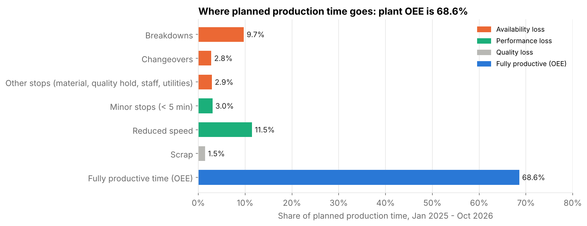
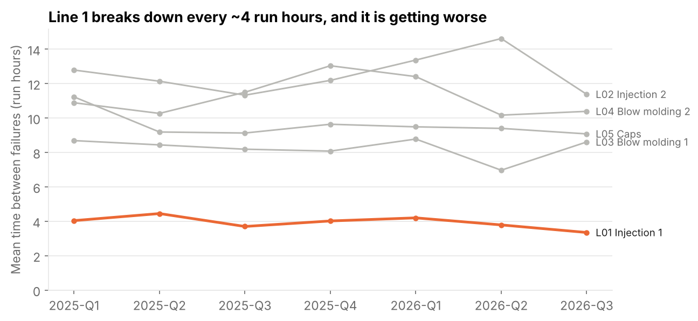
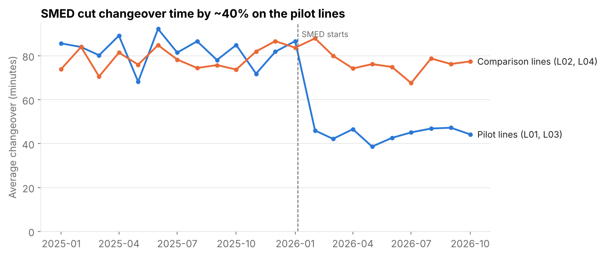
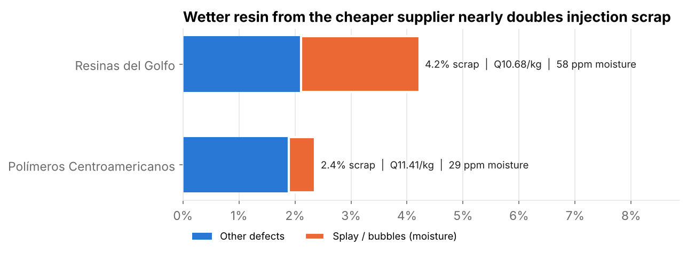
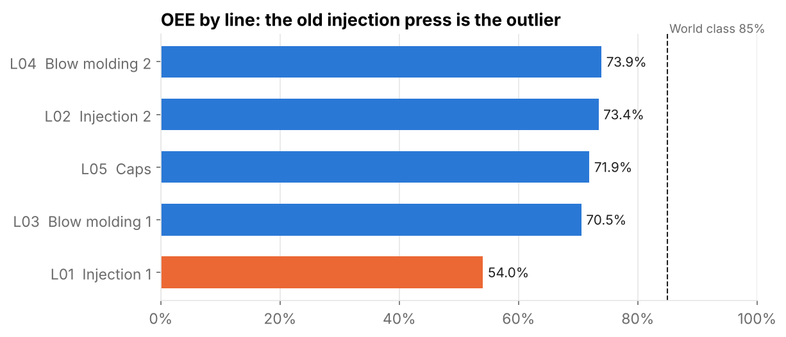
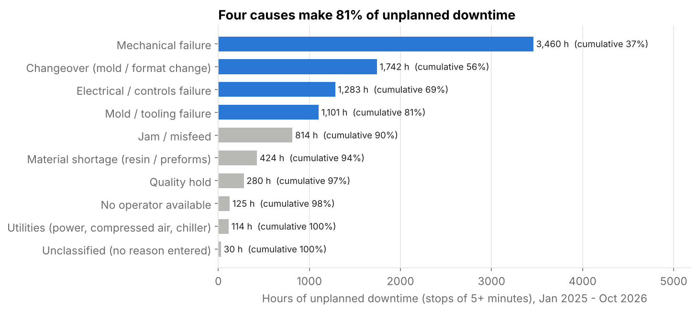
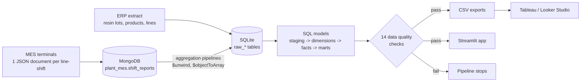

# Manufacturing KPI App: OEE, Downtime and Scrap for a Packaging Plant

A manufacturing case study built around **OEE (Overall Equipment Effectiveness)**. Shift reports from a
plant's MES terminals arrive as nested JSON documents in **MongoDB**, in two different layouts and with the
usual data problems. Aggregation pipelines flatten them, a layered **SQL** warehouse cleans and models
them, and a **Streamlit app** lets the plant manager filter OEE, losses, downtime and scrap by line and date.
The analysis answers the questions every plant meeting asks: **where is capacity being lost, which machine
is the problem, did the improvement program work, and what is it all worth?**

**Stack:** Python (pandas) · MongoDB (aggregation pipelines) · SQL (SQLite: CTEs, window functions, recursive CTE) · Streamlit · matplotlib · pytest · GitHub Actions



---

## The business problem

**Envases del Pacífico** (fictional) makes PET preforms, bottles and caps on five lines in Escuintla,
Guatemala: two injection presses (preforms), two stretch blow molders (bottles) and one cap molder,
three 8-hour shifts, Monday to Saturday. Management needs to answer:

1. **How effective is the plant?** OEE by line, shift and month, split into availability, performance and quality.
2. **Where does the time go?** The six big losses, and which downtime causes matter most (Pareto).
3. **Which machine is the problem?** Reliability (MTBF / MTTR) by line.
4. **Did SMED work?** In January 2026 a quick-changeover program (SMED) started on lines L01 and L03.
   Should it be rolled out to the other lines?
5. **Is the cheaper resin worth it?** About 40% of PET resin now comes from a cheaper supplier. Operators say
   it causes more scrap.

## Key findings

*Default run: 8,377 line-shifts, 65,234 stops and 9,806 production records, January 2025 - October 2026.*

| KPI | 2026 YTD | Same period 2025 | Change |
|---|---|---|---|
| **OEE** | **69.0%** | 68.0% | +1.1 pts |
| Availability | 85.1% | 83.8% | +1.3 pts |
| Performance | 82.8% | 82.8% | 0.0 pts |
| Quality | 98.10% | 98.15% | -0.05 pts |
| Unplanned downtime | 4,179 h | 4,548 h | -8.1% |
| Average changeover | 63 min | 80 min | -21% |

*World-class OEE is about 85%. Ratios are always computed from summed minutes and units, never averaged.*

**Where capacity is lost**
- **Plant OEE is 68.6%.** The two largest losses are **reduced speed (11.5% of planned time)**, because every
  line runs below its rated speed, and **breakdowns (9.7%)**. Scrap costs only 1.5 points of OEE.
- **Four causes make 81% of unplanned downtime:** mechanical failures (37% alone), changeovers, electrical
  failures and mold problems. Long material shortages during the **August-September 2025 port congestion** pulled
  plant OEE down to about 64% for two months.

**The old injection press (L01) is the bottleneck**
- **L01's OEE is 52.9%**, 17 points below the next-worst line (L03, 70.0%). Breakdowns take 18% of its planned time.
- It **breaks down every 3.4-4.5 run hours**, against 11-15 hours for the newer press of the same model (L02), and
  its MTBF has fallen from about 4.3 hours in early 2025 to 3.4 in the last two quarters: the machine is getting worse.
- Bringing L01 up to the best line's OEE would be worth about **Q2.4M a year** in contribution margin. That is
  the size of the business case for an overhaul or a replacement press.



**SMED works; roll it out**
- On the pilot lines the average changeover fell from **82.4 to 48.8 minutes (-41%)**, while the comparison
  lines barely moved (80.0 -> 76.4). The **difference-in-differences** estimate is **-30 minutes per changeover**.
- Changeovers went from 3.6% to 2.0% of planned time (-1.3 points vs comparison), giving **144 hours** back to
  production since January, worth about **Q0.36M a year** on the two pilot lines.
- The gain does not show fully in L01's OEE because its rising breakdowns ate most of it, another reason to fix L01.
- **Recommendation:** extend SMED to L02 and L04 (similar changeover load, worth roughly another Q0.4M a year).



**The cheaper resin raises scrap, but still pays**
- PET resin from *Resinas del Golfo* is **6% cheaper** (Q10.72 vs Q11.39 per kg) but arrives with twice the
  moisture (59 vs 30 ppm). On the injection presses it **raises scrap from 2.4% to 4.1%**, almost all of it
  *splay / bubbles*, the classic moisture defect.
- Over the period it saved **Q2.81M in resin** and cost **Q0.84M in extra scrap**: still a net saving of about Q2M.
- **Recommendation:** keep the supplier, but add a moisture limit to the contract and dry its lots longer,
  rather than switching suppliers.



**Other drivers**
- The **night shift** is up to 3 OEE points lower on every line and scraps about 30% more.
- Product runs that start after a changeover scrap more (injection 3.9% vs 3.0%), the cost of start-up.

| OEE by line | Downtime Pareto |
|---|---|
|  |  |

## SQL case study

[**docs/sql_case_study.md**](docs/sql_case_study.md) answers 10 business questions, each with its query and
result table. The queries live in [`sql/analysis/`](sql/analysis).

| Question | Technique |
|---|---|
| Plant OEE month by month | numerator/denominator aggregation, `LAG()` |
| Lines vs world-class OEE, weakest factor | `RANK()`, OEE decomposition |
| Pareto of downtime causes | running total `SUM() OVER (ORDER BY ...)` |
| Did SMED work? | difference-in-differences with conditional aggregation |
| MTBF / MTTR trend by machine | `LAG() OVER (PARTITION BY line ...)` |
| Resin supplier vs scrap, net of price | joins to the ERP lot table, cost comparison |
| Night shift effect | pivot with `CASE` |
| Longest streak without a breakdown | gaps and islands |
| What the losses are worth | margin per ideal minute |
| Changeover matrix (from SKU -> to SKU) | self-describing pairs, conditional `AVG()` |

## The app

```bash
streamlit run app/streamlit_app.py
```

If the warehouse does not exist yet, the app runs the pipeline once on start (about 10 seconds), so it also
deploys as is to Streamlit Community Cloud. Filter by date range and line; the app shows the OEE tiles, monthly OEE by line, the six big losses, the
downtime Pareto and scrap by defect. All calculations live in [`src/kpi.py`](src/kpi.py), and a test checks
they give the same answers as the SQL marts. The CSV exports in `exports/` also feed Tableau or Looker Studio.

## How it works



| Step | What happens | Code |
|---|---|---|
| **Extract** | Simulates the MES documents (two firmware layouts) and the ERP extract | `src/generate_data.py` |
| **Land** | Saves the raw files and loads the documents into MongoDB | `src/load.py`, `src/mongo_store.py` |
| **Flatten** | Four aggregation pipelines turn nested documents into rows (reports, production, scrap, stops), lining up the v1 and v2 field names but keeping every value as received | `src/mongo_store.py` |
| **Transform** | Four SQL layers: staging (cleaning), dimensions, facts (OEE per shift) and 17 marts | `sql/01_staging.sql` ... `sql/06_marts_quality.sql` |
| **Quality** | 14 checks (every report staged or rejected, no overlapping stops, units reconcile, valid OEE components...); any failure stops the run | `src/quality.py` |
| **Export** | Every `mart_*` table to CSV | `src/export.py` |

If MongoDB is not running, the pipeline flattens the documents in Python instead (same output; a test compares
both paths row by row in CI). `--require-mongo` turns the fallback off.

### OEE definitions

| Term | Definition |
|---|---|
| Planned production time | Shift time minus planned stops (meal break, planned maintenance, no orders) |
| Availability | Run time / planned production time. Availability losses are unplanned stops of **5 minutes or more** |
| Performance | Ideal time of every unit made / run time. Absorbs **minor stops (< 5 min)** and running below the ideal rate |
| Quality | Good units / total units |
| OEE | A x P x Q = ideal time of the good units / planned production time |

A shift can make several SKUs with different ideal rates, so ideal time is summed per SKU. Business rules
(minor-stop threshold, SMED start, world-class target) live in `ref_parameters`, not in the SQL text.

### The raw data is messy on purpose

Real MES extracts are never clean, so the simulator adds the problems the staging layer must fix:

| Problem in the raw extract | Rows affected | Fix in `01_staging.sql` |
|---|---|---|
| Two document layouts (firmware v1 before mid-2025, v2 after) | 1,956 v1 reports | Field names lined up in the aggregation pipelines |
| Counts as text with thousands separators (`"180,000"`) | 2,267 production rows | Cast to integers |
| Line ids typed five ways (`Línea 1`, `L-01`, `l01 `, `LINE 1`, `L01`) | 2,593 reports | Normalized to `L01` |
| Interim report sent before the shift closed, then the final one | 46 shifts | Latest copy kept (`ROW_NUMBER`) |
| SKU codes in lower case or with spaces | 507 rows | `UPPER(TRIM())` |
| Legacy v1 downtime codes (`MECHANICAL`, `SETUP`) and inconsistent case | 16,062 + 3,873 stops | Mapped through `ref_downtime_reasons` |
| No reason entered (`???`) | 127 stops | Kept as *Unclassified* (check: < 1%) |
| Two timestamp formats (`dd/mm/yyyy hh:mm` and ISO) | all v1 stops | Parsed to one format |
| The same stop logged twice | 246 stops | Duplicate removed |
| Stop that ends before it starts (clock error) | 74 stops | Moved to `stg_rejected_downtime_events` |
| Stop still open at the end of the shift | 242 stops | Clipped to the shift end |
| 32-bit counter overflow (4.29 billion units) | 8 reports | Moved to `stg_rejected_shift_reports` |
| Resin lot not scanned | 25 shifts | Set to `UNKNOWN` (check: < 1%) |
| ERP: supplier spelled three ways, mixed date formats, duplicated lot rows | 222 lots | Normalized and deduplicated |

### The data

The data is **synthetic** (no real plant), but generated with realistic mechanics so the analysis has real
signal: per-line failure rates (and an aging press), changeover times that depend on the products, minor
stops, speed losses after changeovers, scrap that depends on process, shift, start-up, humidity and resin
moisture, a supply disruption, storm power cuts and an SMED effect that ramps in over eight weeks.
See [`src/generate_data.py`](src/generate_data.py).

## How to run it

Requires Python 3.10+ (developed on Python 3.14). MongoDB is optional locally.

```bash
git clone https://github.com/pabloanalyst1/manufacturing-kpi-app.git
cd manufacturing-kpi-app
python3 -m venv .venv && source .venv/bin/activate     # Windows: .venv\Scripts\activate
pip install -r requirements.txt

# Optional: MongoDB (macOS with Homebrew, or Docker)
brew tap mongodb/brew && brew install mongodb-community && brew services start mongodb-community
# docker run -d --name mongo -p 27017:27017 mongo:7

python run_pipeline.py               # builds data/warehouse.db and exports/*.csv (~6 seconds)
python -m pytest                     # 22 tests (MongoDB and app tests skip if unavailable)
python scripts/run_case_study.py     # refreshes docs/sql_case_study.md
python scripts/make_readme_charts.py # refreshes the README charts
streamlit run app/streamlit_app.py   # the app
```

The simulated data is identical on every machine (Intel, Apple Silicon, Linux). Each line-shift has its own
random stream, and the generator avoids samplers whose last digit depends on the processor. A test pins a
fingerprint of the default extract, so with the default seed you get exactly the numbers in this README
(8,377 line-shifts).

Without MongoDB the pipeline logs a warning and flattens the documents in Python. To use another server,
set `MONGO_URI` or pass `--mongo-uri`.

## Project structure

```
├── run_pipeline.py              # orchestrates the 6 steps
├── app/streamlit_app.py         # the KPI app
├── src/
│   ├── config.py                # period, shifts, OEE rules, SMED program, paths
│   ├── generate_data.py         # synthetic MES documents + ERP extract (and their data quality problems)
│   ├── mongo_store.py           # MongoDB landing, aggregation pipelines, Python fallback
│   ├── load.py                  # raw files, raw_* and ref_* tables
│   ├── transform.py             # runs the SQL models in order
│   ├── quality.py               # 14 data quality checks
│   ├── export.py                # marts to CSV
│   └── kpi.py                   # filtered KPI calculations for the app
├── sql/
│   ├── 01_staging.sql … 06_marts_quality.sql
│   └── analysis/                # 10 business questions (q01 … q10)
├── tests/                       # hand-made documents with known answers, MongoDB, app and end-to-end tests
├── scripts/                     # case study and README chart generators
├── exports/                     # dashboard-ready CSV files
├── docs/                        # case study, charts
└── .github/workflows/           # CI: MongoDB service, tests on Python 3.12 and 3.14, pipeline
```

## Design decisions

- **MongoDB for what it is good at.** Shift reports are nested and their layout changed with a firmware update;
  a document store takes both as they come. The aggregation pipelines only reshape; all cleaning happens in SQL,
  so the raw layer stays an honest copy of the source.
- **The OEE math is tested on a hand-made shift** where every minute is known (planned stops, a clipped stop,
  a duplicated jam, a clock error, two SKUs with different ideal rates).
- **Minor stops are a performance loss, not availability** (the standard OEE convention), with the 5-minute
  threshold in a reference table.
- **Difference-in-differences, not before/after,** for SMED: the comparison lines show what would have happened anyway.
- **Losses are valued in money** (margin per ideal minute), so "1 OEE point" becomes a number a plant manager can
  compare with the cost of a project.
- **Numerators and denominators are exported, not only ratios,** so the BI tool and the app re-aggregate correctly.
- **Bad rows are set aside with a reason, not deleted,** and the pipeline stops if a quality check fails.

## Next steps

- Tableau / Looker Studio dashboard on the exported marts, and deploying the app to Streamlit Community Cloud.
- Production plan vs actual (schedule attainment) from the ERP.
- A predictive maintenance model for L01 (time to next failure from its stop history).

---

**Author:** José Pablo Arizandieta · [LinkedIn](https://www.linkedin.com/in/pablo-arizandieta) · [GitHub](https://github.com/pabloanalyst1)
